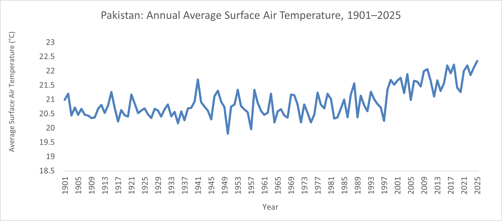

# Climate and Agriculture in Pakistan

## Project overview

This project explores climate trends and their relevance to agriculture in Pakistan using publicly available climate data. It documents the data sources, analytical methods, findings, and limitations in a transparent and reproducible way.

The initial analysis examines historical annual average surface air temperature in Pakistan. Future work may explore the relationship between climate trends and agricultural indicators.

## Research question

How have annual average surface air temperatures in Pakistan changed between 1901 and 2025?

## Data source

* **Provider:** World Bank Climate Change Knowledge Portal
* **Dataset:** CRU TS 4.10
* **Geographical coverage:** Pakistan
* **Variable:** `tas` — average surface air temperature
* **Unit:** Degrees Celsius (°C)
* **Temporal resolution:** Annual
* **Period covered:** 1901–2025, as shown in the downloaded file

The data were downloaded through the portal's spatially aggregated data interface. The original downloaded data are preserved in the Excel workbook.

## Methodology

1. Obtained annual average surface air temperature data for Pakistan from the World Bank Climate Change Knowledge Portal, using the CRU TS 4.10 dataset.
2. Restructured the downloaded data from a wide format into a tidy format, with one row per year.
3. Visualised annual temperatures in a time-series line chart.
4. Calculated mean temperatures for 1901–1930 and 1996–2025 and compared the two periods.
5. Estimated the linear temperature trend using Excel's `SLOPE` function, with year as the independent variable and temperature as the dependent variable.

The analysis is descriptive. It does not test statistical significance, attribute temperature changes to specific causes, or directly assess agricultural impacts.

## Preliminary findings

| Period     | Mean annual temperature |
| ---------- | ----------------------: |
| 1901–1930  |                20.631°C |
| 1996–2025  |                21.621°C |
| Difference |                +0.990°C |

The mean of the annual temperature values in 1996–2025 was approximately 0.99°C higher than in 1901–1930. The time series also displays year-to-year variability alongside an overall upward pattern.

This is a descriptive comparison of two periods. It does not, by itself, establish statistical significance or attribute the difference to a specific cause.

### Long-term temperature trend

A linear regression of annual average surface air temperature for Pakistan over 1901–2025 estimated a warming trend of approximately **0.094°C per decade**. This estimate summarises the linear trend across the study period; it does not establish statistical significance or attribute the observed change to specific causes.

The analysis compares the average temperature in 1901–1930 (20.631°C) with that in 1996–2025 (21.621°C), a difference of approximately **0.990°C** between the two 30-year periods.

## Limitations

* The analysis uses country-level spatially aggregated data and does not capture regional differences within Pakistan.
* The meaning of the `-07` suffix in the downloaded date labels (`YYYY-07`) has not yet been independently verified.
* The linear trend estimate is descriptive; no formal statistical significance test or causal attribution analysis has been conducted.
* The analysis does not directly assess agricultural outcomes or establish a relationship between temperature changes and crop yields.

## Files

* `pakistan_temperature_analysis.xlsx` — Excel workbook containing the original data, cleaned data, calculations, and analysis.
* `pakistan_temperature_trend.png` — Chart of annual average surface air temperature in Pakistan, 1901–2025.

## Next steps

* Verify the date-label convention and document the dataset metadata.
* Consider a formal statistical test of the long-term temperature trend.
* Explore publicly available agricultural data to investigate potential relationships between climate indicators and agricultural outcomes.

## Tools

Microsoft Excel · Data cleaning · Descriptive analysis · Data visualisation · GitHub

